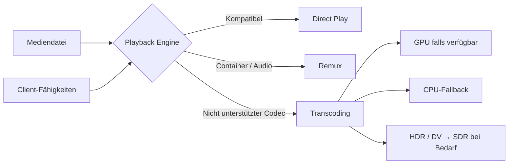
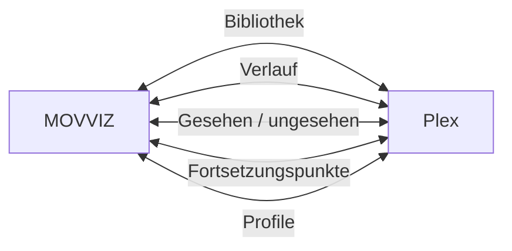
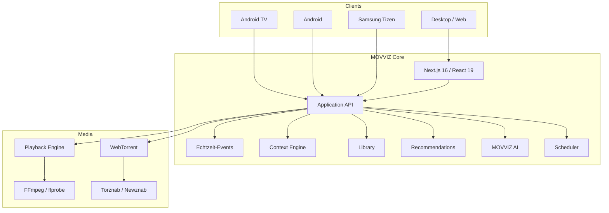

<p align="center">
  <a href="README.md">English</a> · <a href="README.fr.md">Français</a> · <a href="README.nl.md">Nederlands</a> · <strong>Deutsch</strong> · <a href="README.it.md">Italiano</a>
</p>

<div align="center">

<br>


<br>

### Dein Katalog. Dein Server. Deine Regeln.

<p><strong>Aktuelle Version: v1.27.63</strong></p>

**Eine vollständige selbst gehostete Medienplattform — von der Entdeckung bis zur Wiedergabe.**

<br>

<a href="https://github.com/dj41ph4/movviz/releases/latest"></a>
<a href="https://hub.docker.com/r/dj41ph4/movviz"></a>
<a href="https://github.com/dj41ph4/movviz/releases/latest"></a>

<br><br>


<br><br>

**Entdecken · Anfragen · Suchen · Herunterladen · Organisieren · Ansehen · Empfehlen**

<br>

[**Warum MOVVIZ**](#-warum-movviz) · [**Funktionen**](#-eine-app-der-gesamte-workflow) · [**Plattformen**](#-ein-produkt-jeder-bildschirm) · [**Installation**](#-installation) · [**Architektur**](#-architektur) · [**Changelog**](CHANGELOG.de.md)

<br>

</div>

---

## ✦ Warum MOVVIZ

Selbst gehostete Media-Stacks sind leistungsfähig, werden aber oft zu einer Kette einzelner Anwendungen: eine für Anfragen, eine für Filme, eine für Serien, eine für Indexer, eine für Downloads, eine für die Wiedergabe und eine für das Monitoring.

**MOVVIZ macht aus dieser Kette ein einziges Produkt.**

```text
Entdecken
   ↓
Anfragen
   ↓
Die passende Release finden
   ↓
Herunterladen
   ↓
Importieren und organisieren
   ↓
Ansehen
   ↓
Wiedergabeverlauf synchronisieren
   ↓
Empfehlen, was als Nächstes passt
```

Dasselbe System weiß, was du möchtest, was du besitzt, was fehlt, was gerade heruntergeladen wird, was verfügbar ist, was du angesehen hast und was dir als Nächstes gefallen könnte.

> **Ein Benutzerstatus. Eine Oberfläche. Ein Medienuniversum.**

---

## ⚡ Eine App, der gesamte Workflow

<table>
<tr>
<td width="33%" valign="top">

### 🎬 Entdecken

- Cinematic Hero
- Trends und Neuerscheinungen
- Netflix / Disney+ / Prime Video…
- Filme und Serien
- Genres, Studios, Sender
- Schauspieler und Regisseure
- Sammlungen und Sagas
- Veröffentlichungskalender
- Persönliche Vorschläge

</td>
<td width="33%" valign="top">

### 🔎 Beschaffen

- Torznab / Newznab
- Suche über mehrere Indexer
- Release-Scoring
- Konfigurierbare Qualitäten
- Benutzerdefinierte Formate
- Integriertes WebTorrent
- Automatischer Import
- Umbenennen
- Qualitäts-Upgrades

</td>
<td width="33%" valign="top">

### ▶️ Ansehen

- Direct Play
- Remux
- FFmpeg-Transcoding
- Hardwarebeschleunigung
- HDR → SDR bei Bedarf
- Audio / Untertitel
- Intro / Abspann
- Nächste Episode
- Exaktes Fortsetzen

</td>
</tr>
<tr>
<td width="33%" valign="top">

### 👤 Verstehen

- Gesehen / ungesehen
- Verlauf
- Fortschritt
- Bewertungen
- Likes / Dislikes
- Meine Liste
- Präferenzen
- Getrennte Profile
- Empfehlungen

</td>
<td width="33%" valign="top">

### 🧠 Assistieren

- MOVVIZ AI
- Natürliche Konversation
- Bibliothekskontext
- Benutzerverlauf
- Erklärte Empfehlungen
- Faktensuche im Web
- Aktionen in der Anwendung
- Diktat und Sprache

</td>
<td width="33%" valign="top">

### 🩺 Betreiben

- Doctor MOVVIZ
- Dienststatus
- Zentrale Logs
- Geplante Jobs
- FFmpeg-Benchmarks
- CPU / RAM / Latenz
- Backup / Wiederherstellung
- Updates

</td>
</tr>
</table>

---

## 🎞️ Ein Player, der sich an den Client anpasst

MOVVIZ transkodiert nicht standardmäßig. Es wählt abhängig von der Mediendatei und den Fähigkeiten des Geräts die minimal notwendige Verarbeitung.



**Das beste Transcoding ist das, das vermieden wird, wenn es nicht nötig ist.**

---

## 🌊 Integriertes WebTorrent

MOVVIZ enthält eine eigene BitTorrent-Engine auf Basis von **WebTorrent**.

Für den Hauptworkflow ist kein separater Torrent-Client erforderlich.

```text
Film / Serie
    ↓
Indexer durchsuchen
    ↓
Analyse und Scoring
    ↓
Auswahl
    ↓
WebTorrent
    ↓
Download
    ↓
Import / Umbenennen
    ↓
Bibliothek
```

MOVVIZ verwaltet unter anderem Film-/Serien-Warteschlangen, Fortsetzen, Limits, Fortschritt, Seeding nach dem Import, verwaiste Torrents und Qualitäts-Upgrades.

---

## 📺 Ein Produkt, jeder Bildschirm

<table>
<tr>
<td width="25%" valign="top" align="center">

### 🖥 Desktop / Web

Vollständige Oberfläche  
Administration  
Bibliothek  
Entdecken  
Downloads  
Player  
MOVVIZ AI

</td>
<td width="25%" valign="top" align="center">

### 📺 Android TV

**Native App**  
Kotlin  
Jetpack Compose  
Media3  
D-pad  
10-foot UI

</td>
<td width="25%" valign="top" align="center">

### 📱 Android

**Native App**  
Hochformat  
Querformat  
Foldables  
Nativer Player  
Sprach-KI

</td>
<td width="25%" valign="top" align="center">

### 📺 Samsung TV

Tizen  
Fernbedienung  
TV-Oberfläche  
**Status: Beta**

</td>
</tr>
</table>

Das Backend bleibt gemeinsam: Verlauf, Fortsetzungspunkte, Bibliothek, Downloads und Benutzerkontext werden nicht für jeden Bildschirm separat neu implementiert.

---

## 👤 Echter Benutzerkontext

MOVVIZ trennt Konzepte, die getrennt bleiben müssen.

```text
PROFIL
├── Verlauf
├── Gesehen / ungesehen
├── Fortschritt
├── Fortsetzungspunkt
├── Bewertungen
├── Meine Liste
├── Präferenzen
├── Empfehlungen
└── KI-Kontext
```

Denselben Film mehrmals anzusehen erzeugt nicht mehrere Filme. Nach wenigen Minuten abzubrechen bedeutet nicht, dass er als gesehen gilt. Das Löschen eines Fortsetzungspunkts löscht nicht den Verlauf.

Jedes Profil hat seinen eigenen Kontext und seine eigenen Empfehlungen.

---

## 🤖 MOVVIZ AI

MOVVIZ AI ist kein Chatbot, der einfach neben die Anwendung gesetzt wurde.

Es kann den MOVVIZ-Kontext nutzen: Bibliothek, Verlauf, Bewertungen, Präferenzen, Schauspieler, Regisseure, Sammlungen, Verfügbarkeit und den aktuellen Zustand der Anwendung.

```text
„Ich möchte eine kurze, düstere, abgeschlossene Serie,
die ich noch nie gesehen habe.“

MOVVIZ AI
├── versteht die Anfrage
├── prüft deinen Verlauf
├── schließt bereits Gesehenes aus
├── nutzt deine Präferenzen
├── prüft verfügbare Daten
└── schlägt die besten Kandidaten vor
```

Danach kann die Unterhaltung weitergehen:

```text
— Was ist am zweiten besonders?
— Gleiches Genre, aber kürzer.
— Füge den hinzu.
— Spiele ihn ab.
```

Die Anwendung bleibt für Fakten, Daten und Aktionen verantwortlich. Die KI konzentriert sich auf Verstehen, Schlussfolgern, Auswahl und Erklärung.

---

## 🟠 Plex: integriert, niemals erforderlich

Plex ist eine **optionale Integration**, nicht der Kern von MOVVIZ.

MOVVIZ kann Informationen wie Bibliothek, Verlauf, Fortsetzungspunkte, Gesehen-Status oder Profile synchronisieren und lokale Dateien weiterhin ohne Plex verwalten und wiedergeben.



---

## 🔌 Du fängst nicht bei null an

| Quelle | Import / Integration |
| --- | --- |
| **Netflix** | CSV-Wiedergabeverlauf |
| **Plex** | Bibliothek, Verlauf, Fortsetzungspunkte, Profile |
| **Trakt** | Listen |
| **IMDb** | Listen |
| **Letterboxd** | Listen |
| **Seerr / Overseerr** | Bestehende Anfragen |

Benachrichtigungen: Discord, Telegram, Gotify, Slack, Pushbullet und HTTP-Webhooks sowie In-App-Hinweise.

---

## 📅 Automatisierung

MOVVIZ führt die Hintergrundaufgaben aus, die notwendig sind, um alles konsistent zu halten:

**heutige Releases · fehlende Episoden · RSS · Qualitäts-Upgrades · Metadaten · Importe · Indexer · Downloads · Plex · Intros · Abspann · Papierkorb · Diagnose · Benchmarks · Backups**

Benutzeraktionen haben weiterhin Vorrang vor Hintergrundarbeit.

---

## 🏗 Architektur



### Technischer Stack

| Ebene | Technologie |
| --- | --- |
| Web / Server | **Next.js 16** |
| UI | **React 19** |
| Sprache | **TypeScript strict** |
| Styling | **Tailwind CSS 4** |
| Animationen | **Framer Motion** |
| Web-Player | **HLS.js / DASH.js / MP4Box** |
| Media | **FFmpeg / ffprobe** |
| Torrent | **WebTorrent** |
| Android TV | **Kotlin / Jetpack Compose / Media3** |
| Android mobile | **Kotlin / Jetpack Compose / Media3** |
| Echtzeit | **Server-Sent Events** |
| State | **SQLite + atomisches JSON** |

---

## 🚀 Installation

<table>
<tr>
<td width="25%" valign="top">

### 🪟 Windows

Lade den Installer aus den [Releases](https://github.com/dj41ph4/movviz/releases/latest) herunter.

Windows-Dienst und integriertes Update-System enthalten.

</td>
<td width="25%" valign="top">

### 🐧 Linux

```bash
tar -xzf movviz-linux-x64.tar.gz
cd movviz
sudo ./packaging/linux/install.sh
```

x64 und ARM64.

</td>
<td width="25%" valign="top">

### 🐳 Docker / NAS

```bash
docker pull dj41ph4/movviz:latest
cd packaging/docker
sh up.sh
```

amd64 und arm64.

Der Start aktiviert die NAS-iGPU, falls sie verfügbar ist. [GPU/iGPU-Einrichtung](packaging/docker/GPU.md); nach jedem Image-Update `sh up.sh` erneut ausführen.

</td>
<td width="25%" valign="top">

### 📺 Android

Android-TV- und Android-Mobile-APKs sind in den Releases verfügbar.

</td>
</tr>
</table>

Beim ersten Zugriff führt `/setup` durch die Erstellung des Administratorkontos und die Konfiguration der erforderlichen Dienste.

**Standardports: Web `9810` · BitTorrent `9820` · Resolver `9830` · Peer-to-Peer `55000`/`55001`**

---

## 🌍 Sprachen

🇬🇧 English · 🇫🇷 Français · 🇳🇱 Nederlands · 🇩🇪 Deutsch · 🇮🇹 Italiano

Anleitungen: [English](docs/guide-en.md) · [Français](docs/guide-fr.md) · [Nederlands](docs/guide-nl.md) · [Deutsch](docs/guide-de.md) · [Italiano](docs/guide-it.md)

---

## 🧭 Mehr entdecken

- [Changelog](CHANGELOG.de.md)
- [Dokumentation](docs/)
- [Android TV](android-tv-nx/)
- [Android mobile](android-mobile-nx/)
- [Samsung Tizen](tizen-tv/)
- [Docker Hub](https://hub.docker.com/r/dj41ph4/movviz)
- [Neueste Release](https://github.com/dj41ph4/movviz/releases/latest)
- [Projekt über GitHub Sponsors unterstützen](https://github.com/sponsors/dj41ph4)

---

<div align="center">


### MOVVIZ

**Dein Katalog. Dein Server. Deine Regeln.**

Open source · Self-hosted · GPL-3.0

</div>
