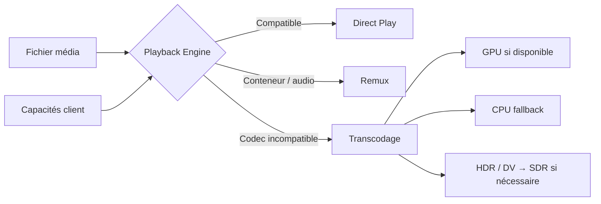
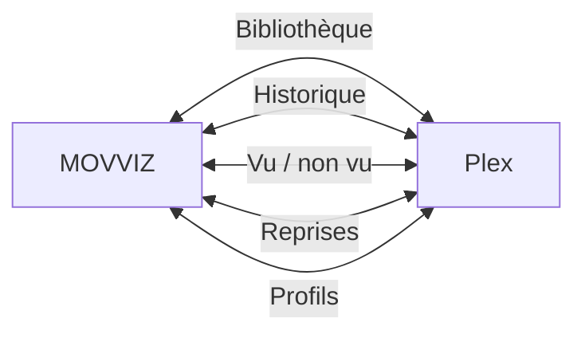
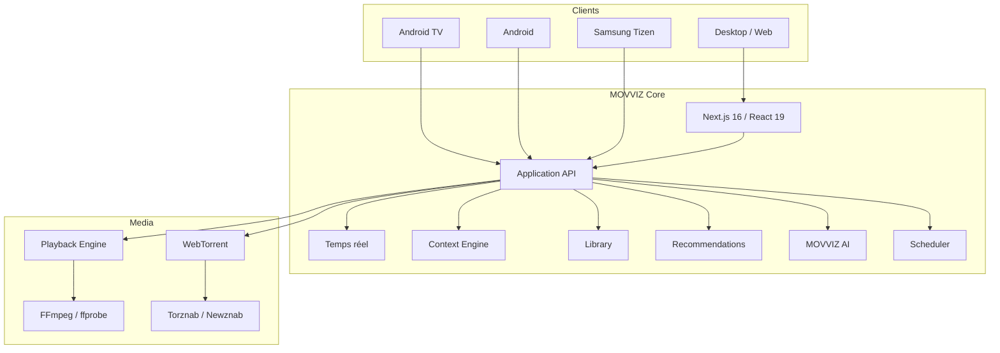

<p align="center">
  <a href="README.md">English</a> · <strong>Français</strong> · <a href="README.nl.md">Nederlands</a> · <a href="README.de.md">Deutsch</a> · <a href="README.it.md">Italiano</a>
</p>

<div align="center">

<br>


<br>

### Ton catalogue. Ton serveur. Tes règles.

<p><strong>Version actuelle : v1.27.56</strong></p>

**Une plateforme média auto-hébergée complète — de la découverte jusqu'à la lecture.**

<br>

<a href="https://github.com/dj41ph4/movviz/releases/latest"></a>
<a href="https://hub.docker.com/r/dj41ph4/movviz"></a>
<a href="https://github.com/dj41ph4/movviz/releases/latest"></a>

<br><br>


<br><br>

**Découvrir · Demander · Chercher · Télécharger · Organiser · Regarder · Recommander**

<br>

[**Pourquoi MOVVIZ**](#-pourquoi-movviz) · [**Fonctionnalités**](#-une-seule-application-tout-le-workflow) · [**Écrans**](#-un-produit-tous-tes-écrans) · [**Installation**](#-installation) · [**Architecture**](#-architecture) · [**Changelog**](CHANGELOG.md)

<br>

</div>

---

## ✦ Pourquoi MOVVIZ

Les stacks média auto-hébergées sont puissantes, mais elles finissent souvent par devenir une chaîne d'applications : une pour les demandes, une pour les films, une pour les séries, une pour les indexeurs, une pour télécharger, une pour lire, une pour surveiller.

**MOVVIZ transforme cette chaîne en un seul produit.**

```text
Découvrir
   ↓
Demander
   ↓
Trouver la bonne release
   ↓
Télécharger
   ↓
Importer et organiser
   ↓
Regarder
   ↓
Synchroniser l'historique
   ↓
Recommander la suite
```

Le même système connaît ce que tu veux, ce que tu possèdes, ce qui manque, ce qui se télécharge, ce qui est disponible, ce que tu as regardé et ce qui pourrait te plaire ensuite.

> **Un seul état utilisateur. Une seule interface. Un seul univers média.**

---

## ⚡ Une seule application, tout le workflow

<table>
<tr>
<td width="33%" valign="top">

### 🎬 Découvrir

- Hero cinématique
- Tendances et nouveautés
- Netflix / Disney+ / Prime Video…
- Films et séries
- Genres, studios, chaînes
- Acteurs et réalisateurs
- Collections et sagas
- Calendrier des sorties
- Suggestions personnelles

</td>
<td width="33%" valign="top">

### 🔎 Acquérir

- Torznab / Newznab
- Recherche multi-indexeurs
- Score des releases
- Qualités configurables
- Formats personnalisés
- WebTorrent intégré
- Import automatique
- Renommage
- Upgrades qualité

</td>
<td width="33%" valign="top">

### ▶️ Regarder

- Direct Play
- Remux
- Transcodage FFmpeg
- Accélération matérielle
- HDR → SDR si nécessaire
- Audio / sous-titres
- Intro / générique
- Épisode suivant
- Reprise exacte

</td>
</tr>
<tr>
<td width="33%" valign="top">

### 👤 Comprendre

- Vu / non vu
- Historique
- Progression
- Notes
- Likes / dislikes
- Ma liste
- Préférences
- Profils isolés
- Recommandations

</td>
<td width="33%" valign="top">

### 🧠 Assister

- MOVVIZ AI
- Conversation naturelle
- Contexte bibliothèque
- Historique utilisateur
- Recommandations expliquées
- Recherche web factuelle
- Actions dans l'application
- Dictée et voix

</td>
<td width="33%" valign="top">

### 🩺 Exploiter

- Doctor MOVVIZ
- Santé des services
- Logs centralisés
- Jobs planifiés
- Benchmarks FFmpeg
- CPU / RAM / latence
- Sauvegarde / restauration
- Mises à jour

</td>
</tr>
</table>

---

## 🎞️ Un player qui s'adapte au client

MOVVIZ ne transcode pas par défaut. Il choisit le traitement minimal nécessaire selon le fichier et les capacités de l'appareil.



**Le meilleur transcodage est celui qu'on évite quand il n'est pas nécessaire.**

---

## 🌊 WebTorrent intégré

MOVVIZ embarque son propre moteur BitTorrent basé sur **WebTorrent**.

Pas besoin d'un client torrent séparé pour le workflow principal.

```text
Film / Série
    ↓
Recherche indexeurs
    ↓
Analyse et score
    ↓
Sélection
    ↓
WebTorrent
    ↓
Téléchargement
    ↓
Import / renommage
    ↓
Bibliothèque
```

MOVVIZ gère notamment les files films/séries, la reprise, les limites, la progression, le seed après import, les torrents orphelins et les upgrades de qualité.

---

## 📺 Un produit, tous tes écrans

<table>
<tr>
<td width="25%" valign="top" align="center">

### 🖥 Desktop / Web

Interface complète  
Administration  
Bibliothèque  
Découverte  
Téléchargements  
Player  
MOVVIZ AI

</td>
<td width="25%" valign="top" align="center">

### 📺 Android TV

**Application native**  
Kotlin  
Jetpack Compose  
Media3  
D-pad  
10-foot UI

</td>
<td width="25%" valign="top" align="center">

### 📱 Android

**Application native**  
Portrait  
Paysage  
Foldables  
Player natif  
IA vocale

</td>
<td width="25%" valign="top" align="center">

### 📺 Samsung TV

Tizen  
Télécommande  
Interface TV  
**Statut : bêta**

</td>
</tr>
</table>

Le backend reste commun : l'historique, les reprises, la bibliothèque, les téléchargements et le contexte utilisateur ne sont pas réinventés séparément pour chaque écran.

---

## 👤 Un vrai contexte utilisateur

MOVVIZ distingue les concepts qui doivent rester séparés.

```text
PROFIL
├── Historique
├── Vu / non vu
├── Progression
├── Reprise
├── Notes
├── Ma liste
├── Préférences
├── Recommandations
└── Contexte IA
```

Regarder plusieurs fois le même film ne crée pas plusieurs films. Quitter après quelques minutes ne signifie pas qu'il est vu. Supprimer une reprise n'efface pas l'historique.

Chaque profil possède son propre contexte et ses propres recommandations.

---

## 🤖 MOVVIZ AI

MOVVIZ AI n'est pas un chatbot posé à côté de l'application.

Il peut utiliser le contexte MOVVIZ : bibliothèque, historique, notes, préférences, acteurs, réalisateurs, collections, disponibilité et état courant de l'application.

```text
« Je veux une série courte, sombre, terminée,
que je n'ai jamais vue. »

MOVVIZ AI
├── comprend la demande
├── consulte ton historique
├── exclut ce que tu as déjà vu
├── utilise tes préférences
├── vérifie les données disponibles
└── propose les meilleurs candidats
```

Puis la conversation peut continuer :

```text
— Le deuxième a quoi de particulier ?
— Même genre, mais plus court.
— Ajoute celui-là.
— Lance-le.
```

L'application reste responsable des faits, des données et des actions. L'IA se concentre sur la compréhension, le raisonnement, le choix et l'explication.

---

## 🟠 Plex : intégré, jamais obligatoire

Plex est une **intégration facultative**, pas le cœur de MOVVIZ.

MOVVIZ peut synchroniser des informations telles que la bibliothèque, l'historique, les reprises, les états vus ou les profils, tout en restant capable de gérer et lire ses fichiers locaux sans Plex.



---

## 🔌 Tu ne repars pas de zéro

| Source | Import / intégration |
| --- | --- |
| **Netflix** | Historique CSV |
| **Plex** | Bibliothèque, historique, reprises, profils |
| **Trakt** | Listes |
| **IMDb** | Listes |
| **Letterboxd** | Listes |
| **Seerr / Overseerr** | Demandes existantes |

Notifications : Discord, Telegram, Gotify, Slack, Pushbullet et webhooks HTTP, avec alertes dans l’application.

---

## 📅 Automatisation

MOVVIZ exécute les tâches de fond nécessaires pour maintenir l'ensemble cohérent :

**sorties du jour · épisodes manquants · RSS · upgrades qualité · métadonnées · imports · indexeurs · téléchargements · Plex · intros · crédits · corbeille · diagnostic · benchmark · sauvegarde**

Les actions utilisateur restent prioritaires sur le travail de fond.

---

## 🏗 Architecture



### Stack technique

| Couche | Technologie |
| --- | --- |
| Web / serveur | **Next.js 16** |
| UI | **React 19** |
| Langage | **TypeScript strict** |
| Styling | **Tailwind CSS 4** |
| Animations | **Framer Motion** |
| Player Web | **HLS.js / DASH.js / MP4Box** |
| Média | **FFmpeg / ffprobe** |
| Torrent | **WebTorrent** |
| Android TV | **Kotlin / Jetpack Compose / Media3** |
| Android mobile | **Kotlin / Jetpack Compose / Media3** |
| Temps réel | **Server-Sent Events** |
| État | **SQLite + JSON atomiques** |

---

## 🚀 Installation

<table>
<tr>
<td width="25%" valign="top">

### 🪟 Windows

Télécharge l'installeur depuis les [Releases](https://github.com/dj41ph4/movviz/releases/latest).

Service Windows et système de mise à jour intégrés.

</td>
<td width="25%" valign="top">

### 🐧 Linux

```bash
tar -xzf movviz-linux-x64.tar.gz
cd movviz
sudo ./packaging/linux/install.sh
```

x64 et ARM64.

</td>
<td width="25%" valign="top">

### 🐳 Docker / NAS

```bash
docker pull dj41ph4/movviz:latest
cd packaging/docker
sh up.sh
```

amd64 et arm64.

Le lancement active l'iGPU du NAS s'il est accessible. [Configuration GPU/iGPU](packaging/docker/GPU.md) ; relancer `sh up.sh` après chaque mise à jour de l'image.

</td>
<td width="25%" valign="top">

### 📺 Android

APK Android TV et Android mobile disponibles dans les Releases.

</td>
</tr>
</table>

Au premier accès, `/setup` guide la création du compte administrateur et le réglage des services nécessaires.

**Ports par défaut : Web `9810` · BitTorrent `9820` · résolveur `9830` · pair-à-pair `55000`/`55001`**

---

## 🌍 Langues

🇬🇧 English · 🇫🇷 Français · 🇳🇱 Nederlands · 🇩🇪 Deutsch · 🇮🇹 Italiano

Guides : [English](docs/guide-en.md) · [Français](docs/guide-fr.md) · [Nederlands](docs/guide-nl.md) · [Deutsch](docs/guide-de.md) · [Italiano](docs/guide-it.md)

---

## 🧭 Pour aller plus loin

- [Changelog](CHANGELOG.md)
- [Documentation](docs/)
- [Android TV](android-tv-nx/)
- [Android mobile](android-mobile-nx/)
- [Samsung Tizen](tizen-tv/)
- [Docker Hub](https://hub.docker.com/r/dj41ph4/movviz)
- [Dernière release](https://github.com/dj41ph4/movviz/releases/latest)
- [Soutenir le projet sur GitHub Sponsors](https://github.com/sponsors/dj41ph4)

---

<div align="center">


### MOVVIZ

**Ton catalogue. Ton serveur. Tes règles.**

Open source · Self-hosted · GPL-3.0

</div>
