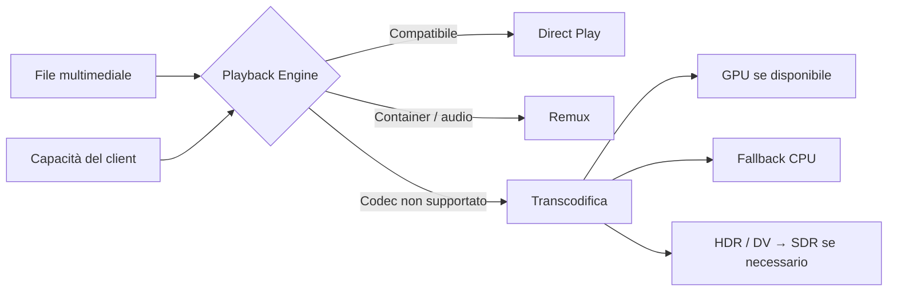
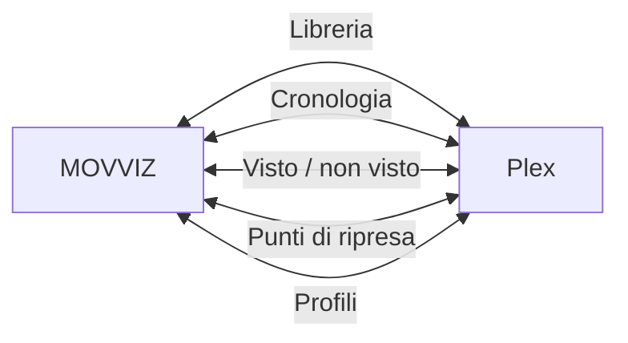
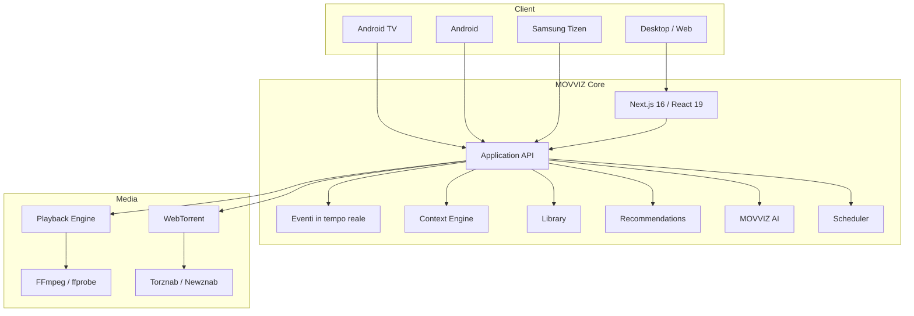

<p align="center">
  <a href="README.md">English</a> · <a href="README.fr.md">Français</a> · <a href="README.nl.md">Nederlands</a> · <a href="README.de.md">Deutsch</a> · <strong>Italiano</strong>
</p>

<div align="center">

<br>


<br>

### Il tuo catalogo. Il tuo server. Le tue regole.

<p><strong>Versione attuale: v1.27.62</strong></p>

**Una piattaforma multimediale self-hosted completa — dalla scoperta alla riproduzione.**

<br>

<a href="https://github.com/dj41ph4/movviz/releases/latest"></a>
<a href="https://hub.docker.com/r/dj41ph4/movviz"></a>
<a href="https://github.com/dj41ph4/movviz/releases/latest"></a>

<br><br>


<br><br>

**Scopri · Richiedi · Cerca · Scarica · Organizza · Guarda · Consiglia**

<br>

[**Perché MOVVIZ**](#-perché-movviz) · [**Funzionalità**](#-una-sola-app-lintero-workflow) · [**Piattaforme**](#-un-prodotto-ogni-schermo) · [**Installazione**](#-installazione) · [**Architettura**](#-architettura) · [**Changelog**](CHANGELOG.it.md)

<br>

</div>

---

## ✦ Perché MOVVIZ

Gli stack multimediali self-hosted sono potenti, ma spesso diventano una catena di applicazioni separate: una per le richieste, una per i film, una per le serie, una per gli indexer, una per i download, una per la riproduzione e una per il monitoraggio.

**MOVVIZ trasforma questa catena in un unico prodotto.**

```text
Scopri
   ↓
Richiedi
   ↓
Trova la release giusta
   ↓
Scarica
   ↓
Importa e organizza
   ↓
Guarda
   ↓
Sincronizza la cronologia
   ↓
Consiglia cosa vedere dopo
```

Lo stesso sistema sa cosa vuoi, cosa possiedi, cosa manca, cosa è in download, cosa è disponibile, cosa hai già visto e cosa potrebbe piacerti dopo.

> **Un solo stato utente. Una sola interfaccia. Un solo universo multimediale.**

---

## ⚡ Una sola app, l'intero workflow

<table>
<tr>
<td width="33%" valign="top">

### 🎬 Scopri

- Hero cinematografico
- Tendenze e novità
- Netflix / Disney+ / Prime Video…
- Film e serie
- Generi, studi, canali
- Attori e registi
- Collezioni e saghe
- Calendario delle uscite
- Suggerimenti personali

</td>
<td width="33%" valign="top">

### 🔎 Acquisisci

- Torznab / Newznab
- Ricerca multi-indexer
- Punteggio delle release
- Qualità configurabili
- Formati personalizzati
- WebTorrent integrato
- Importazione automatica
- Rinomina
- Upgrade di qualità

</td>
<td width="33%" valign="top">

### ▶️ Guarda

- Direct Play
- Remux
- Transcodifica FFmpeg
- Accelerazione hardware
- HDR → SDR quando necessario
- Audio / sottotitoli
- Intro / titoli di coda
- Episodio successivo
- Ripresa esatta

</td>
</tr>
<tr>
<td width="33%" valign="top">

### 👤 Comprendi

- Visto / non visto
- Cronologia
- Avanzamento
- Valutazioni
- Like / dislike
- La mia lista
- Preferenze
- Profili separati
- Raccomandazioni

</td>
<td width="33%" valign="top">

### 🧠 Assisti

- MOVVIZ AI
- Conversazione naturale
- Contesto della libreria
- Cronologia utente
- Raccomandazioni spiegate
- Ricerca web fattuale
- Azioni nell'app
- Dettatura e voce

</td>
<td width="33%" valign="top">

### 🩺 Gestisci

- Doctor MOVVIZ
- Stato dei servizi
- Log centralizzati
- Job pianificati
- Benchmark FFmpeg
- CPU / RAM / latenza
- Backup / ripristino
- Aggiornamenti

</td>
</tr>
</table>

---

## 🎞️ Un player che si adatta al client

MOVVIZ non transcodifica per impostazione predefinita. Sceglie il trattamento minimo necessario in base al file multimediale e alle capacità del dispositivo.



**La migliore transcodifica è quella che eviti quando non serve.**

---

## 🌊 WebTorrent integrato

MOVVIZ include un proprio motore BitTorrent basato su **WebTorrent**.

Non è necessario un client torrent separato per il workflow principale.

```text
Film / Serie
    ↓
Ricerca negli indexer
    ↓
Analisi e punteggio
    ↓
Selezione
    ↓
WebTorrent
    ↓
Download
    ↓
Importazione / rinomina
    ↓
Libreria
```

MOVVIZ gestisce code film/serie, ripresa, limiti, avanzamento, seed dopo l'importazione, torrent orfani e upgrade di qualità.

---

## 📺 Un prodotto, ogni schermo

<table>
<tr>
<td width="25%" valign="top" align="center">

### 🖥 Desktop / Web

Interfaccia completa  
Amministrazione  
Libreria  
Scoperta  
Download  
Player  
MOVVIZ AI

</td>
<td width="25%" valign="top" align="center">

### 📺 Android TV

**App nativa**  
Kotlin  
Jetpack Compose  
Media3  
D-pad  
10-foot UI

</td>
<td width="25%" valign="top" align="center">

### 📱 Android

**App nativa**  
Verticale  
Orizzontale  
Foldable  
Player nativo  
AI vocale

</td>
<td width="25%" valign="top" align="center">

### 📺 Samsung TV

Tizen  
Telecomando  
Interfaccia TV  
**Stato: beta**

</td>
</tr>
</table>

Il backend resta condiviso: cronologia, punti di ripresa, libreria, download e contesto utente non vengono reimplementati separatamente per ogni schermo.

---

## 👤 Un vero contesto utente

MOVVIZ mantiene separati i concetti che devono restare separati.

```text
PROFILO
├── Cronologia
├── Visto / non visto
├── Avanzamento
├── Punto di ripresa
├── Valutazioni
├── La mia lista
├── Preferenze
├── Raccomandazioni
└── Contesto AI
```

Guardare più volte lo stesso film non crea più film. Interrompere dopo pochi minuti non significa che sia stato visto. Eliminare un punto di ripresa non cancella la cronologia.

Ogni profilo ha il proprio contesto e le proprie raccomandazioni.

---

## 🤖 MOVVIZ AI

MOVVIZ AI non è un chatbot semplicemente aggiunto accanto all'applicazione.

Può usare il contesto MOVVIZ: libreria, cronologia, valutazioni, preferenze, attori, registi, collezioni, disponibilità e stato corrente dell'applicazione.

```text
“Voglio una serie breve, cupa, conclusa,
che non ho mai visto.”

MOVVIZ AI
├── comprende la richiesta
├── controlla la tua cronologia
├── esclude ciò che hai già visto
├── usa le tue preferenze
├── verifica i dati disponibili
└── propone i candidati migliori
```

Poi la conversazione può continuare:

```text
— Cosa ha di particolare il secondo?
— Stesso genere, ma più corto.
— Aggiungi quello.
— Avvialo.
```

L'applicazione resta responsabile di fatti, dati e azioni. L'AI si concentra su comprensione, ragionamento, scelta e spiegazione.

---

## 🟠 Plex: integrato, mai obbligatorio

Plex è un'**integrazione opzionale**, non il cuore di MOVVIZ.

MOVVIZ può sincronizzare informazioni come libreria, cronologia, punti di ripresa, stati visto/non visto o profili, continuando comunque a gestire e riprodurre file locali senza Plex.



---

## 🔌 Non riparti da zero

| Fonte | Importazione / integrazione |
| --- | --- |
| **Netflix** | Cronologia CSV |
| **Plex** | Libreria, cronologia, punti di ripresa, profili |
| **Trakt** | Liste |
| **IMDb** | Liste |
| **Letterboxd** | Liste |
| **Seerr / Overseerr** | Richieste esistenti |

Notifiche: Discord, Telegram, Gotify, Slack, Pushbullet e webhook HTTP, oltre agli avvisi nell'applicazione.

---

## 📅 Automazione

MOVVIZ esegue le attività in background necessarie per mantenere tutto coerente:

**uscite del giorno · episodi mancanti · RSS · upgrade di qualità · metadati · importazioni · indexer · download · Plex · intro · titoli di coda · cestino · diagnostica · benchmark · backup**

Le azioni dell'utente restano prioritarie rispetto al lavoro in background.

---

## 🏗 Architettura



### Stack tecnico

| Livello | Tecnologia |
| --- | --- |
| Web / server | **Next.js 16** |
| UI | **React 19** |
| Linguaggio | **TypeScript strict** |
| Styling | **Tailwind CSS 4** |
| Animazioni | **Framer Motion** |
| Player Web | **HLS.js / DASH.js / MP4Box** |
| Media | **FFmpeg / ffprobe** |
| Torrent | **WebTorrent** |
| Android TV | **Kotlin / Jetpack Compose / Media3** |
| Android mobile | **Kotlin / Jetpack Compose / Media3** |
| Tempo reale | **Server-Sent Events** |
| Stato | **SQLite + JSON atomico** |

---

## 🚀 Installazione

<table>
<tr>
<td width="25%" valign="top">

### 🪟 Windows

Scarica l'installer dalle [Releases](https://github.com/dj41ph4/movviz/releases/latest).

Servizio Windows e sistema di aggiornamento integrato inclusi.

</td>
<td width="25%" valign="top">

### 🐧 Linux

```bash
tar -xzf movviz-linux-x64.tar.gz
cd movviz
sudo ./packaging/linux/install.sh
```

x64 e ARM64.

</td>
<td width="25%" valign="top">

### 🐳 Docker / NAS

```bash
docker pull dj41ph4/movviz:latest
cd packaging/docker
sh up.sh
```

amd64 e arm64.

L'avvio abilita la iGPU del NAS se disponibile. [Configurazione GPU/iGPU](packaging/docker/GPU.md); rieseguire `sh up.sh` dopo ogni aggiornamento dell'immagine.

</td>
<td width="25%" valign="top">

### 📺 Android

Gli APK Android TV e Android mobile sono disponibili nelle Releases.

</td>
</tr>
</table>

Al primo accesso, `/setup` guida la creazione dell'account amministratore e la configurazione dei servizi necessari.

**Porte predefinite: Web `9810` · BitTorrent `9820` · resolver `9830` · peer-to-peer `55000`/`55001`**

---

## 🌍 Lingue

🇬🇧 English · 🇫🇷 Français · 🇳🇱 Nederlands · 🇩🇪 Deutsch · 🇮🇹 Italiano

Guide: [English](docs/guide-en.md) · [Français](docs/guide-fr.md) · [Nederlands](docs/guide-nl.md) · [Deutsch](docs/guide-de.md) · [Italiano](docs/guide-it.md)

---

## 🧭 Per saperne di più

- [Changelog](CHANGELOG.it.md)
- [Documentazione](docs/)
- [Android TV](android-tv-nx/)
- [Android mobile](android-mobile-nx/)
- [Samsung Tizen](tizen-tv/)
- [Docker Hub](https://hub.docker.com/r/dj41ph4/movviz)
- [Ultima release](https://github.com/dj41ph4/movviz/releases/latest)
- [Supporta il progetto su GitHub Sponsors](https://github.com/sponsors/dj41ph4)

---

<div align="center">


### MOVVIZ

**Il tuo catalogo. Il tuo server. Le tue regole.**

Open source · Self-hosted · GPL-3.0

</div>
