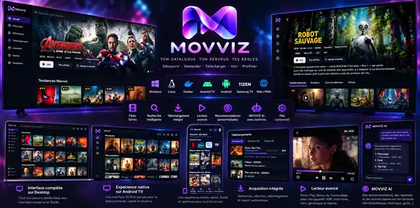
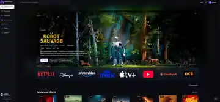
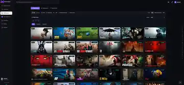
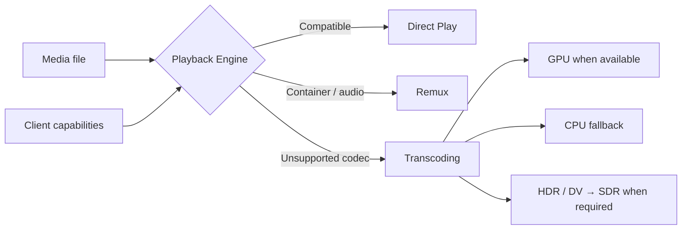
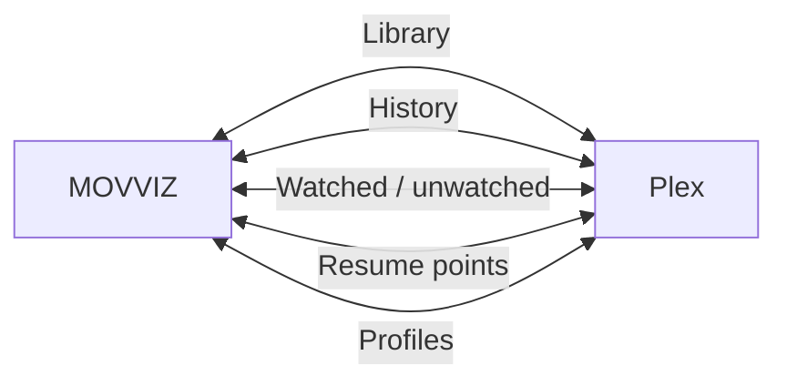
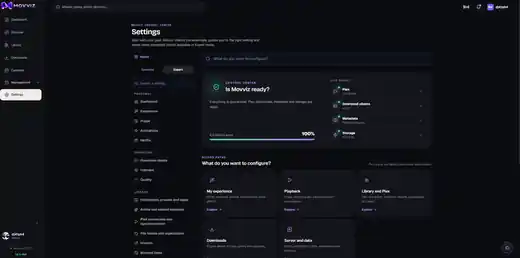
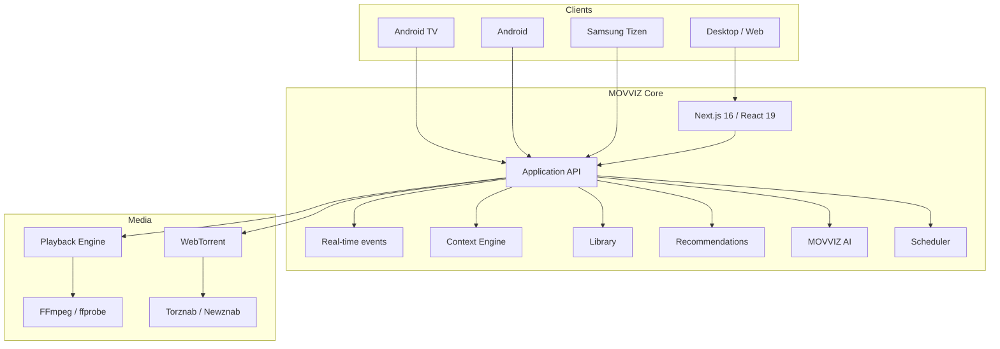

<p align="center">
  <strong>English</strong> · <a href="README.fr.md">Français</a> · <a href="README.nl.md">Nederlands</a> · <a href="README.de.md">Deutsch</a> · <a href="README.it.md">Italiano</a>
</p>

<div align="center">

<br>


<br>

### Your catalog. Your server. Your rules.

<p><strong>Current version: v1.28.00</strong></p>

**A complete self-hosted media platform — from discovery to playback.**

<br>

<a href="https://github.com/dj41ph4/movviz/releases/latest"></a>
<a href="https://hub.docker.com/r/dj41ph4/movviz"></a>
<a href="https://github.com/dj41ph4/movviz/releases/latest"></a>

<br><br>


<br><br>

**Discover · Request · Search · Download · Organize · Watch · Recommend**

<br><br>



<br><br>

[**Why MOVVIZ**](#-why-movviz) · [**Features**](#-one-app-the-entire-workflow) · [**Platforms**](#-one-product-every-screen) · [**Installation**](#-installation) · [**Architecture**](#-architecture) · [**Changelog**](CHANGELOG.en.md)

<br>

</div>

---

## ✦ Why MOVVIZ

Self-hosted media stacks are powerful, but they often turn into a chain of separate applications: one for requests, one for movies, one for TV shows, one for indexers, one for downloading, one for playback, and one for monitoring.

**MOVVIZ turns that chain into a single product.**

```text
Discover
   ↓
Request
   ↓
Find the right release
   ↓
Download
   ↓
Import and organize
   ↓
Watch
   ↓
Sync viewing history
   ↓
Recommend what comes next
```

The same system knows what you want, what you own, what is missing, what is downloading, what is available, what you have watched, and what you might enjoy next.

> **One user state. One interface. One media universe.**

<table>
<tr>
<td width="50%" align="center"></td>
<td width="50%" align="center"></td>
</tr>
<tr>
<td align="center"><sub><b>Discover</b> — cinematic discovery, services and recommendations.</sub></td>
<td align="center"><sub><b>Your library</b> — one place for movies, series, collections and availability.</sub></td>
</tr>
</table>

---

## ⚡ One app, the entire workflow

<table>
<tr>
<td width="33%" valign="top">

### 🎬 Discover

- Cinematic hero
- Trending and new releases
- Netflix / Disney+ / Prime Video…
- Movies and TV shows
- Genres, studios, networks
- Actors and directors
- Collections and sagas
- Release calendar
- Personal suggestions

</td>
<td width="33%" valign="top">

### 🔎 Acquire

- Torznab / Newznab
- Multi-indexer search
- Release scoring
- Configurable qualities
- Custom formats
- Integrated WebTorrent
- Automatic import
- Renaming
- Quality upgrades

</td>
<td width="33%" valign="top">

### ▶️ Watch

- Direct Play
- Remux
- FFmpeg transcoding
- Hardware acceleration
- HDR → SDR when required
- Audio / subtitles
- Intro / credits
- Next episode
- Exact resume point

</td>
</tr>
<tr>
<td width="33%" valign="top">

### 👤 Understand

- Watched / unwatched
- History
- Progress
- Ratings
- Likes / dislikes
- My List
- Preferences
- Isolated profiles
- Recommendations

</td>
<td width="33%" valign="top">

### 🧠 Assist

- MOVVIZ AI
- Natural conversation
- Library context
- User history
- Explained recommendations
- Fact-checking web search
- In-app actions
- Dictation and voice

</td>
<td width="33%" valign="top">

### 🩺 Operate

- Doctor MOVVIZ
- Service health
- Centralized logs
- Scheduled jobs
- FFmpeg benchmarks
- CPU / RAM / latency
- Backup / restore
- Updates

</td>
</tr>
</table>

---

## 🎞️ A player that adapts to the client

MOVVIZ does not transcode by default. It chooses the lightest processing path required by the media file and the capabilities of the device.



**The best transcode is the one you avoid when it is not needed.**

---

## 🌊 Integrated WebTorrent

MOVVIZ includes its own BitTorrent engine based on **WebTorrent**.

No separate torrent client is required for the main workflow.

```text
Movie / TV show
    ↓
Indexer search
    ↓
Analysis and scoring
    ↓
Selection
    ↓
WebTorrent
    ↓
Download
    ↓
Import / rename
    ↓
Library
```

MOVVIZ handles movie/TV queues, resume, limits, progress, seeding after import, orphaned torrents, and quality upgrades.

---

## 📺 One product, every screen

<table>
<tr>
<td width="25%" valign="top" align="center">

### 🖥 Desktop / Web

Full interface  
Administration  
Library  
Discovery  
Downloads  
Player  
MOVVIZ AI

</td>
<td width="25%" valign="top" align="center">

### 📺 Android TV

**Native app**  
Kotlin  
Jetpack Compose  
Media3  
D-pad  
10-foot UI

</td>
<td width="25%" valign="top" align="center">

### 📱 Android

**Native app**  
Portrait  
Landscape  
Foldables  
Native player  
Voice AI

</td>
<td width="25%" valign="top" align="center">

### 📺 Samsung TV

Tizen  
Remote control  
TV interface  
**Status: beta**

</td>
</tr>
</table>

The backend remains shared: history, resume points, library, downloads, and user context are not reimplemented separately for each screen.

<p align="center">
  
</p>
<p align="center"><sub><b>Native Android client</b> — the same library, history and downloads in a touch-first interface.</sub></p>

---

## 👤 Real user context

MOVVIZ keeps concepts separate when they need to remain separate.

```text
PROFILE
├── History
├── Watched / unwatched
├── Progress
├── Resume point
├── Ratings
├── My List
├── Preferences
├── Recommendations
└── AI context
```

Watching the same movie several times does not create several movies. Leaving after a few minutes does not mark it as watched. Clearing a resume point does not erase viewing history.

Each profile has its own context and its own recommendations.

---

## 🤖 MOVVIZ AI

MOVVIZ AI is not a chatbot bolted onto the side of the application.

It can use MOVVIZ context: library, history, ratings, preferences, actors, directors, collections, availability, and the application's current state.

```text
“I want a short, dark, finished series
that I have never watched.”

MOVVIZ AI
├── understands the request
├── checks your history
├── excludes what you already watched
├── uses your preferences
├── verifies available data
└── suggests the best candidates
```

Then the conversation can continue:

```text
— What is special about the second one?
— Same genre, but shorter.
— Add that one.
— Play it.
```

The application remains responsible for facts, data, and actions. AI focuses on understanding, reasoning, choosing, and explaining.

---

## 🟠 Plex: integrated, never required

Plex is an **optional integration**, not the core of MOVVIZ.

MOVVIZ can synchronize information such as the library, history, resume points, watched states, or profiles while remaining fully capable of managing and playing local files without Plex.



---

## 🔌 You do not start from scratch

| Source | Import / integration |
| --- | --- |
| **Netflix** | CSV viewing history |
| **Plex** | Library, history, resume points, profiles |
| **Trakt** | Lists |
| **IMDb** | Lists |
| **Letterboxd** | Lists |
| **Seerr / Overseerr** | Existing requests |

Notifications: Discord, Telegram, Gotify, Slack, Pushbullet, and HTTP webhooks, plus in-app alerts.

---

## 📅 Automation

MOVVIZ runs the background tasks required to keep everything consistent:

**today's releases · missing episodes · RSS · quality upgrades · metadata · imports · indexers · downloads · Plex · intros · credits · recycle bin · diagnostics · benchmarks · backups**

User actions remain higher priority than background work.

---

## ⚙️ Built to be operated, not babysat

MOVVIZ keeps day-to-day operation visible instead of hiding it behind configuration files. The Control Center checks the essentials, exposes guided paths for common tasks, and keeps advanced controls available in Expert mode when you need them.

<p align="center">
  
</p>

**Live health checks · guided configuration · Essential and Expert modes · diagnostics in one place.**

---

## 🏗 Architecture



### Technical stack

| Layer | Technology |
| --- | --- |
| Web / server | **Next.js 16** |
| UI | **React 19** |
| Language | **TypeScript strict** |
| Styling | **Tailwind CSS 4** |
| Animations | **Framer Motion** |
| Web player | **HLS.js / DASH.js / MP4Box** |
| Media | **FFmpeg / ffprobe** |
| Torrent | **WebTorrent** |
| Android TV | **Kotlin / Jetpack Compose / Media3** |
| Android mobile | **Kotlin / Jetpack Compose / Media3** |
| Real-time | **Server-Sent Events** |
| State | **SQLite + atomic JSON** |

---

## 🚀 Installation

<table>
<tr>
<td width="25%" valign="top">

### 🪟 Windows

Download the installer from [Releases](https://github.com/dj41ph4/movviz/releases/latest).

Windows service and integrated update system included.

</td>
<td width="25%" valign="top">

### 🐧 Linux

```bash
tar -xzf movviz-linux-x64.tar.gz
cd movviz
sudo ./packaging/linux/install.sh
```

x64 and ARM64.

</td>
<td width="25%" valign="top">

### 🐳 Docker / NAS

```bash
docker pull dj41ph4/movviz:latest
cd packaging/docker
sh up.sh
```

amd64 and arm64.

`up.sh` automatically maps an Intel/AMD NAS render device when available; see
[GPU/iGPU setup](packaging/docker/GPU.md). Re-run it after image updates.

</td>
<td width="25%" valign="top">

### 📺 Android

Android TV and Android mobile APKs are available in Releases.

</td>
</tr>
</table>

On first access, `/setup` guides you through creating the administrator account and configuring the required services.

**Default ports: Web `9810` · BitTorrent `9820` · resolver `9830` · peer-to-peer `55000`/`55001`**

---

## 🌍 Languages

🇬🇧 English · 🇫🇷 Français · 🇳🇱 Nederlands · 🇩🇪 Deutsch · 🇮🇹 Italiano

Guides: [English](docs/guide-en.md) · [Français](docs/guide-fr.md) · [Nederlands](docs/guide-nl.md) · [Deutsch](docs/guide-de.md) · [Italiano](docs/guide-it.md)

---

## 🧭 Go further

- [Changelog](CHANGELOG.en.md)
- [Documentation](docs/)
- [Android TV](android-tv-nx/)
- [Android mobile](android-mobile-nx/)
- [Samsung Tizen](tizen-tv/)
- [Docker Hub](https://hub.docker.com/r/dj41ph4/movviz)
- [Latest release](https://github.com/dj41ph4/movviz/releases/latest)
- [Support the project on GitHub Sponsors](https://github.com/sponsors/dj41ph4)

---

<div align="center">


### MOVVIZ

**Your catalog. Your server. Your rules.**

Open source · Self-hosted · GPL-3.0

</div>
