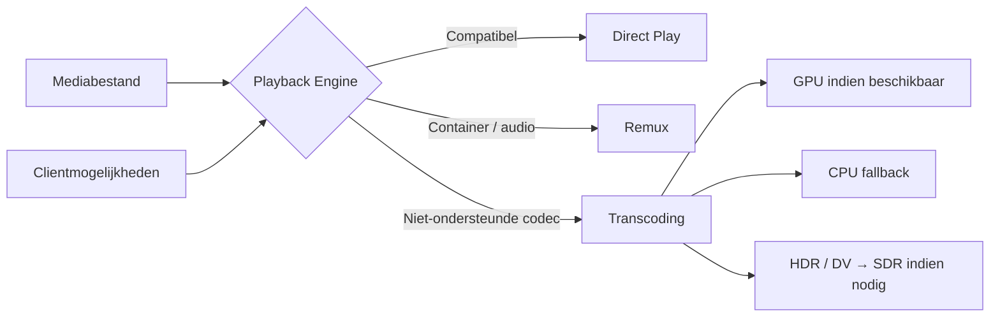
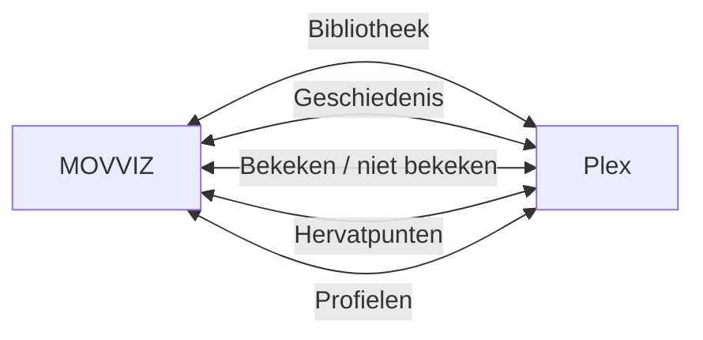
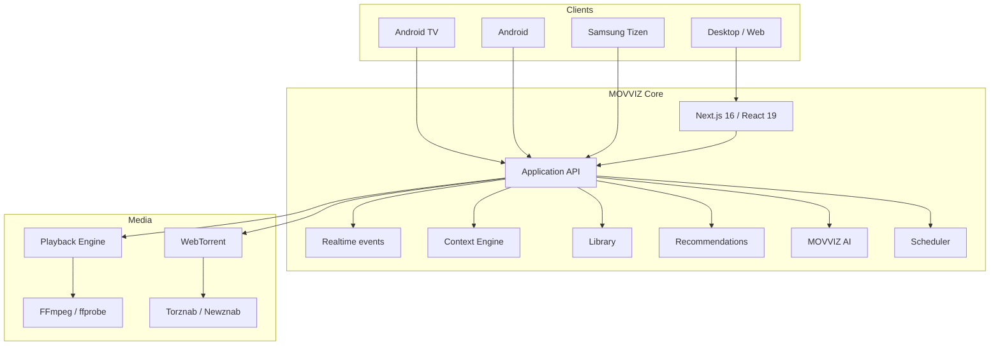

<p align="center">
  <a href="README.md">English</a> · <a href="README.fr.md">Français</a> · <strong>Nederlands</strong> · <a href="README.de.md">Deutsch</a> · <a href="README.it.md">Italiano</a>
</p>

<div align="center">

<br>


<br>

### Jouw catalogus. Jouw server. Jouw regels.

<p><strong>Huidige versie: v1.27.64</strong></p>

**Een compleet self-hosted mediaplatform — van ontdekking tot afspelen.**

<br>

<a href="https://github.com/dj41ph4/movviz/releases/latest"></a>
<a href="https://hub.docker.com/r/dj41ph4/movviz"></a>
<a href="https://github.com/dj41ph4/movviz/releases/latest"></a>

<br><br>


<br><br>

**Ontdekken · Aanvragen · Zoeken · Downloaden · Organiseren · Kijken · Aanbevelen**

<br>

[**Waarom MOVVIZ**](#-waarom-movviz) · [**Functies**](#-één-app-de-volledige-workflow) · [**Schermen**](#-één-product-elk-scherm) · [**Installatie**](#-installatie) · [**Architectuur**](#-architectuur) · [**Changelog**](CHANGELOG.nl.md)

<br>

</div>

---

## ✦ Waarom MOVVIZ

Self-hosted mediastacks zijn krachtig, maar veranderen vaak in een keten van losse toepassingen: één voor aanvragen, één voor films, één voor series, één voor indexers, één voor downloads, één voor afspelen en één voor monitoring.

**MOVVIZ maakt van die keten één product.**

```text
Ontdekken
   ↓
Aanvragen
   ↓
De juiste release vinden
   ↓
Downloaden
   ↓
Importeren en organiseren
   ↓
Kijken
   ↓
Kijkgeschiedenis synchroniseren
   ↓
Aanbevelen wat hierna komt
```

Hetzelfde systeem weet wat je wilt, wat je bezit, wat ontbreekt, wat wordt gedownload, wat beschikbaar is, wat je hebt bekeken en wat je daarna waarschijnlijk leuk vindt.

> **Eén gebruikersstatus. Eén interface. Eén media-universum.**

---

## ⚡ Eén app, de volledige workflow

<table>
<tr>
<td width="33%" valign="top">

### 🎬 Ontdekken

- Cinematische hero
- Trends en nieuwigheden
- Netflix / Disney+ / Prime Video…
- Films en series
- Genres, studio's, zenders
- Acteurs en regisseurs
- Collecties en saga's
- Releasekalender
- Persoonlijke suggesties

</td>
<td width="33%" valign="top">

### 🔎 Verkrijgen

- Torznab / Newznab
- Zoeken over meerdere indexers
- Release-scoring
- Instelbare kwaliteiten
- Aangepaste formaten
- Geïntegreerde WebTorrent
- Automatische import
- Hernoemen
- Kwaliteitsupgrades

</td>
<td width="33%" valign="top">

### ▶️ Kijken

- Direct Play
- Remux
- FFmpeg-transcoding
- Hardwareversnelling
- HDR → SDR indien nodig
- Audio / ondertitels
- Intro / aftiteling
- Volgende aflevering
- Exact hervatten

</td>
</tr>
<tr>
<td width="33%" valign="top">

### 👤 Begrijpen

- Bekeken / niet bekeken
- Geschiedenis
- Voortgang
- Beoordelingen
- Likes / dislikes
- Mijn lijst
- Voorkeuren
- Gescheiden profielen
- Aanbevelingen

</td>
<td width="33%" valign="top">

### 🧠 Assisteren

- MOVVIZ AI
- Natuurlijke gesprekken
- Bibliotheekcontext
- Gebruikersgeschiedenis
- Verklaarde aanbevelingen
- Feitelijke webzoekopdrachten
- Acties in de app
- Dicteren en spraak

</td>
<td width="33%" valign="top">

### 🩺 Beheren

- Doctor MOVVIZ
- Gezondheid van services
- Gecentraliseerde logs
- Geplande jobs
- FFmpeg-benchmarks
- CPU / RAM / latency
- Back-up / herstel
- Updates

</td>
</tr>
</table>

---

## 🎞️ Een speler die zich aanpast aan de client

MOVVIZ transcodeert niet standaard. Het kiest de lichtste verwerking die nodig is op basis van het mediabestand en de mogelijkheden van het apparaat.



**De beste transcode is degene die je vermijdt wanneer hij niet nodig is.**

---

## 🌊 Geïntegreerde WebTorrent

MOVVIZ bevat een eigen BitTorrent-engine gebaseerd op **WebTorrent**.

Voor de hoofdworkflow is geen aparte torrentclient nodig.

```text
Film / Serie
    ↓
Indexers doorzoeken
    ↓
Analyse en scoring
    ↓
Selectie
    ↓
WebTorrent
    ↓
Download
    ↓
Import / hernoemen
    ↓
Bibliotheek
```

MOVVIZ beheert onder andere film-/seriequeues, hervatten, limieten, voortgang, seeden na import, verweesde torrents en kwaliteitsupgrades.

---

## 📺 Eén product, elk scherm

<table>
<tr>
<td width="25%" valign="top" align="center">

### 🖥 Desktop / Web

Volledige interface  
Beheer  
Bibliotheek  
Ontdekken  
Downloads  
Player  
MOVVIZ AI

</td>
<td width="25%" valign="top" align="center">

### 📺 Android TV

**Native app**  
Kotlin  
Jetpack Compose  
Media3  
D-pad  
10-foot UI

</td>
<td width="25%" valign="top" align="center">

### 📱 Android

**Native app**  
Portret  
Liggend  
Foldables  
Native player  
Spraak-AI

</td>
<td width="25%" valign="top" align="center">

### 📺 Samsung TV

Tizen  
Afstandsbediening  
TV-interface  
**Status: beta**

</td>
</tr>
</table>

De backend blijft gemeenschappelijk: geschiedenis, hervatpunten, bibliotheek, downloads en gebruikerscontext worden niet apart voor elk scherm opnieuw geïmplementeerd.

---

## 👤 Echte gebruikerscontext

MOVVIZ houdt concepten gescheiden wanneer ze gescheiden moeten blijven.

```text
PROFIEL
├── Geschiedenis
├── Bekeken / niet bekeken
├── Voortgang
├── Hervatpunt
├── Beoordelingen
├── Mijn lijst
├── Voorkeuren
├── Aanbevelingen
└── AI-context
```

Dezelfde film meerdere keren bekijken maakt niet meerdere films aan. Na enkele minuten stoppen betekent niet dat hij als bekeken geldt. Een hervatpunt verwijderen wist de kijkgeschiedenis niet.

Elk profiel heeft zijn eigen context en aanbevelingen.

---

## 🤖 MOVVIZ AI

MOVVIZ AI is geen chatbot die naast de applicatie is geplakt.

Het kan MOVVIZ-context gebruiken: bibliotheek, geschiedenis, beoordelingen, voorkeuren, acteurs, regisseurs, collecties, beschikbaarheid en de huidige toestand van de applicatie.

```text
“Ik wil een korte, donkere, afgeronde serie
Die ik nog nooit heb gezien.”

MOVVIZ AI
├── begrijpt de vraag
├── controleert je geschiedenis
├── sluit uit wat je al hebt gezien
├── gebruikt je voorkeuren
├── controleert beschikbare gegevens
└── stelt de beste kandidaten voor
```

Daarna kan het gesprek doorgaan:

```text
— Wat is er speciaal aan de tweede?
— Zelfde genre, maar korter.
— Voeg die toe.
— Speel hem af.
```

De applicatie blijft verantwoordelijk voor feiten, gegevens en acties. De AI richt zich op begrip, redenering, keuze en uitleg.

---

## 🟠 Plex: geïntegreerd, nooit verplicht

Plex is een **optionele integratie**, niet de kern van MOVVIZ.

MOVVIZ kan informatie synchroniseren zoals bibliotheek, geschiedenis, hervatpunten, bekeken-statussen of profielen, en blijft tegelijk in staat lokale bestanden zonder Plex te beheren en af te spelen.



---

## 🔌 Je begint niet vanaf nul

| Bron | Import / integratie |
| --- | --- |
| **Netflix** | CSV-kijkgeschiedenis |
| **Plex** | Bibliotheek, geschiedenis, hervatpunten, profielen |
| **Trakt** | Lijsten |
| **IMDb** | Lijsten |
| **Letterboxd** | Lijsten |
| **Seerr / Overseerr** | Bestaande aanvragen |

Meldingen: Discord, Telegram, Gotify, Slack, Pushbullet en HTTP-webhooks, plus waarschuwingen in de app.

---

## 📅 Automatisering

MOVVIZ voert de achtergrondtaken uit die nodig zijn om alles consistent te houden:

**releases van vandaag · ontbrekende afleveringen · RSS · kwaliteitsupgrades · metadata · imports · indexers · downloads · Plex · intro's · aftiteling · prullenbak · diagnose · benchmarks · back-ups**

Gebruikersacties krijgen altijd voorrang op achtergrondwerk.

---

## 🏗 Architectuur



### Technische stack

| Laag | Technologie |
| --- | --- |
| Web / server | **Next.js 16** |
| UI | **React 19** |
| Taal | **TypeScript strict** |
| Styling | **Tailwind CSS 4** |
| Animaties | **Framer Motion** |
| Webplayer | **HLS.js / DASH.js / MP4Box** |
| Media | **FFmpeg / ffprobe** |
| Torrent | **WebTorrent** |
| Android TV | **Kotlin / Jetpack Compose / Media3** |
| Android mobile | **Kotlin / Jetpack Compose / Media3** |
| Realtime | **Server-Sent Events** |
| State | **SQLite + atomische JSON** |

---

## 🚀 Installatie

<table>
<tr>
<td width="25%" valign="top">

### 🪟 Windows

Download het installatieprogramma via [Releases](https://github.com/dj41ph4/movviz/releases/latest).

Windows-service en geïntegreerd updatesysteem inbegrepen.

</td>
<td width="25%" valign="top">

### 🐧 Linux

```bash
tar -xzf movviz-linux-x64.tar.gz
cd movviz
sudo ./packaging/linux/install.sh
```

x64 en ARM64.

</td>
<td width="25%" valign="top">

### 🐳 Docker / NAS

```bash
docker pull dj41ph4/movviz:latest
cd packaging/docker
sh up.sh
```

amd64 en arm64.

Bij het starten wordt de NAS-iGPU ingeschakeld als die beschikbaar is. [GPU/iGPU-configuratie](packaging/docker/GPU.md); voer `sh up.sh` opnieuw uit na elke image-update.

</td>
<td width="25%" valign="top">

### 📺 Android

Android TV- en Android mobile-APK's zijn beschikbaar in Releases.

</td>
</tr>
</table>

Bij de eerste toegang begeleidt `/setup` je bij het aanmaken van het beheerdersaccount en het configureren van de vereiste services.

**Standaardpoorten: Web `9810` · BitTorrent `9820` · resolver `9830` · peer-to-peer `55000`/`55001`**

---

## 🌍 Talen

🇬🇧 English · 🇫🇷 Français · 🇳🇱 Nederlands · 🇩🇪 Deutsch · 🇮🇹 Italiano

Handleidingen: [English](docs/guide-en.md) · [Français](docs/guide-fr.md) · [Nederlands](docs/guide-nl.md) · [Deutsch](docs/guide-de.md) · [Italiano](docs/guide-it.md)

---

## 🧭 Meer ontdekken

- [Changelog](CHANGELOG.nl.md)
- [Documentatie](docs/)
- [Android TV](android-tv-nx/)
- [Android mobile](android-mobile-nx/)
- [Samsung Tizen](tizen-tv/)
- [Docker Hub](https://hub.docker.com/r/dj41ph4/movviz)
- [Nieuwste release](https://github.com/dj41ph4/movviz/releases/latest)
- [Steun het project via GitHub Sponsors](https://github.com/sponsors/dj41ph4)

---

<div align="center">


### MOVVIZ

**Jouw catalogus. Jouw server. Jouw regels.**

Open source · Self-hosted · GPL-3.0

</div>
